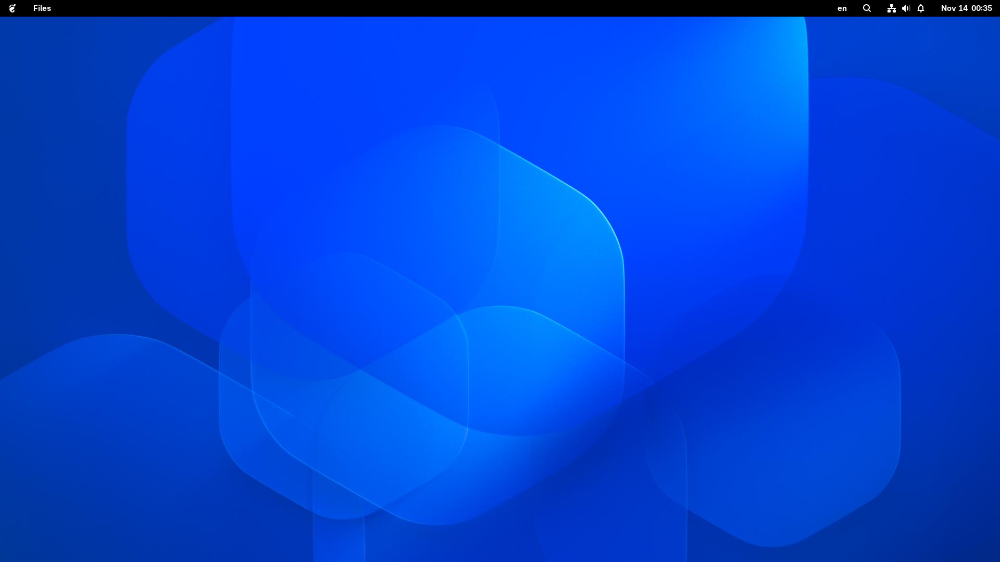

# G5 51

## Screenshot

### A New GNOME Environment

G5 5.1 is an independent desktop environment built on GNOME Shell.

It aims to provide an alternative GNOME experience while preserving the simplicity, usability, and familiar workflow of the original GNOME desktop.

Rather than replacing GNOME, GNOME 5.1 offers another way to experience it.

---

## Overview

G5 5.1 builds upon the existing GNOME desktop environment, introducing its own interface and desktop experience while maintaining compatibility with the GNOME ecosystem.

The goal is to stay close to GNOME while providing a distinct and consistent user experience.

## Features

- **Independent Session**  
  A separate desktop session that can be selected from the login screen.

- **Custom Panel**  
  A redesigned panel with a custom menu and integrated GNOME Shell components.

- **GNOME Integration**  
  Designed to work with existing GNOME applications, libraries, and Settings.

- **Familiar Experience**  
  Retains the familiar foundations of GNOME while introducing its own interface.

- **Coexistence with GNOME**  
  Designed to coexist with the standard GNOME session.

## Philosophy

G5 5.1 is not intended to replace GNOME.

It is an alternative GNOME environment that builds upon GNOME's existing technologies and design principles.

Our focus is on:

- Staying close to the GNOME ecosystem.
- Maintaining compatibility with standard GNOME components.
- Providing a simple and consistent desktop experience.
- Keeping the standard GNOME session available.

## Project Status

G5 5.1 is currently under development.

The desktop session is functional, and GNOME Settings integration is working.

Installation and distribution are among the next development goals.

## Installation

Installation instructions will be provided once the packaging and distribution process is ready.

## License

License information will be added.

---

**G5 5.1 — A New GNOME Environment.**
